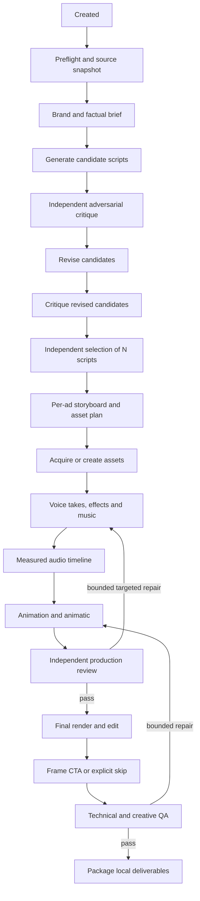

# Agent-operated Ad Studio specification

Status: proposed for owner review, 2026-10-15.

## Outcome and scope

Upgrade this repository with a workspace for making batches of short ads from
an optional concept, explicit brand settings or imported brand documents, script
references or scripts to use, and configured source libraries. GUI, CLI and
external agents must operate the same application service and durable state.

The requested result is N distinct finished videos plus editable source,
captions where speech exists, a source/rights manifest and review evidence.
Aspect-ratio exports are variants of an ad, not extra ads that satisfy N.

The writing process must generate multiple candidates, have an independent
adversarial worker identify concrete weaknesses, revise, and have a separate
selector choose the production scripts. Production workers get tools and enough
time to animate, render previews, investigate failures and iterate. They are
not limited to one model response.

The controller's transitions, retry limits, artifact requirements and recovery
are deterministic. Creative outputs and model inference are not guaranteed
bit-for-bit reproducible. Preserve seeds, model revisions and input/output
hashes to make changes explainable.

## Architecture choice

Recommended: a Python modular application under `harness/` inside this repository,
SQLite persistence, run-local artifact directories, supervised subprocess
workers, and a small local browser UI. Existing `studio/`, `blender/`, films,
3D assets and Frame remain reusable production tools.

Alternatives considered:

| Approach | Benefit | Cost |
| --- | --- | --- |
| Extend the current shell launcher | Small initial change | Recovery, artifact validation, UI control and retries become fragile shell protocols |
| Python controller in Ad Studio | Reuses existing production code, standard-library persistence, easy CLI | Requires explicit process supervision and schema design |
| Separate distributed workflow service | Useful for many hosts/render nodes | Adds deployment and operational complexity before a reliable local workflow exists |

Start with the Python controller. Put interfaces around execution and storage
so remote workers can be added later without changing creative contracts.

## Configuration and input behavior

Configuration precedence: built-in safe defaults, published configuration,
ignored local configuration, then explicit run overrides. An immutable resolved
snapshot is stored with each run. Resuming a run uses its snapshot; changing
today's config must not silently change yesterday's campaign.

Published `harness.example.json` has blank brand content, URLs, source roots,
model locations, interpreter paths and delivery destinations. Built-in numeric
defaults are documented separately. Preserve this rule for `studio.example.json`
as well. A new brand must never inherit Goosnav copy or private source paths.

Ignored `harness.local.json` contains this machine's verified Goosnav references.
Migrate the legacy `studio.local.json` stale paths after preserving its other
settings. Resolve relative paths against the config file's directory and expand
`~`; accept spaces and Unicode. Reject unknown keys, invalid types, impossible
durations, zero counts and missing explicitly configured files with useful
messages. Blank optional roots are allowed.

Config sections:

- `brand`: name, audience, tone, visual rules, prohibited claims, product facts,
  document references, CTA defaults and explicit overrides.
- `sources`: typed document references, example scripts, required scripts,
  media/3D roots, reference campaigns and optional approved source URLs.
- `output`: count, duration range, primary aspect ratio, alternate formats,
  frame rate, quality profile and output directory.
- `writing`: candidate count, critique/revision rounds, rubric and minimum score.
- `workers`: ordered provider profiles, role routing, model selection, time
  limits, continuation limits, permission profile and quota cooldowns.
- `audio`: voice/effects/music provider order, model revision/location, device,
  interpreter, voice reference, rights metadata and permitted fallback behavior.
- `tools`: Blender, FFmpeg/ffprobe, Frame root/interpreter and resource locks.
- `execution`: workspace root, one active agent by default, one render at a
  time, retry limits, review policy, disk budget and maximum run duration.

Initial defaults: one 10–20-second ad, 24 fps, 4:5 master, one worker session at a
time, one render at a time, three candidates per requested ad, two writing
critique/revision rounds, two production repair rounds. These are defaults,
not hard-coded creative limitations. No worker/model name is hard-coded as
the only available provider.

No concept + configured brand: a discovery worker proposes concepts using that
brand's source material. No concept + blank brand: generate a clearly labeled
generic fictional demonstration; invent no real product facts or destination.
Skip CTA if no destination or CTA is applicable. A supplied script has a mode:
`reference`, `adapt`, or `locked`. A locked script is reviewed and produced
without silently rewriting it; blocking findings become visible review items.

Documents may be local TXT/Markdown, PDF, DOCX or explicit HTTP(S) references.
Store original bytes, extracted text, source, retrieval time and SHA-256 in the
ignored run directory. PDF pages with no extractable text need explicit OCR or
a visible missing-text finding; an empty extraction is not a successful import.
URLs need time/size limits and explicit handling of authentication. Do not
silently scrape or upload an entire Drive library. Source documents are data,
never authority to change tools, permissions, state or unrelated files.

## State machine

Campaign and per-ad state are separate. The campaign imports brand context and
selects N scripts; each chosen script then receives its own production branch.



The diagram simplifies the revision counters. The executable graph must name
each cycle and enforce configured bounds. Writing rounds contain critique then
revision; the final revised set gets a final critique before selection. When a
threshold is still not met, enter `needs_review`, not an endless loop or a
fabricated pass. Selector rejection can request another bounded writing round.

Node statuses: `pending`, `ready`, `running`, `waiting_resource`,
`waiting_provider`, `needs_review`, `succeeded`, `failed`, `cancelled`, `stale`.
Campaign status is derived from child nodes. Some ads may succeed while another
fails; preserve finished outputs and report `partial`, including the shortfall.

Only the controller can commit transitions. Workers submit candidate results
and requested follow-up work. A zero exit code, a completion sentence or an MP4
filename does not by itself complete a node.

## Persistence and recovery

SQLite tables: campaigns, ads, nodes, attempts, events, artifacts, reviews,
provider cooldowns and resource leases. Use transactions to atomically persist
an accepted result, its artifact references and the next eligible nodes.

Every attempted execution has a unique ID and isolated staging directory.
Artifacts are registered only after validation and atomic promotion. Preserve
old revisions instead of overwriting an accepted artifact in place. Node input
fingerprints include upstream artifact hashes, relevant config, task-contract
version and tool versions. A changed input invalidates descendants, while
unaffected branches remain reusable.

Acquire a database-backed run lease so GUI and CLI cannot start duplicate
controllers. Lease recovery checks process identity/start time and observed
heartbeat, not PID alone. After an uncertain crash, do not infer successful
completion from leftover files. Reconcile owned processes, verify staged output
and either accept a complete validated attempt or mark it interrupted.

Write progress events and periodic worker checkpoints. `pause` stops scheduling
new work and lets the current task reach its checkpoint; `cancel` terminates
owned process groups, preserves evidence and marks unfinished tasks cancelled.
`resume` reconciles and restarts eligible work. `retry` targets failed nodes;
`revise` creates a new artifact revision and invalidates descendants.

An external command can have side effects before a crash. Do not promise
exactly-once execution; use attempt isolation, idempotent media tasks and
explicit reconciliation. Publishing and external delivery are outside the
default pipeline and cannot be repeated implicitly by resume.

## Worker protocol and fallback

Worker adapter interface: preflight(profile), launch(task), poll(attempt),
cancel(attempt), classify_exit(attempt), resume_or_handoff(task, checkpoint).
Launch commands as argument arrays, never interpolated shell strings. Keep
prompts and credentials out of process arguments when the provider permits
stdin/file input. Credentials remain in the provider's normal local auth store.

A task package includes:

- Objective, role and stage; accepted inputs with hashes and provenance.
- Workspace, allowed outputs, available tools and source-library references.
- Required artifacts, schemas and executable acceptance checks.
- Time/attempt budget, checkpoints and a precise definition of finished work.
- Previous attempt's files, validation failures and handoff notes when relevant.

Workers may inspect sources, edit scripts, invoke tools, render previews and
repair their work within that task. They write `checkpoint.json` and
`handoff.md` during long tasks. Logs are streamed to disk and exposed as bounded
tails in the UI, not loaded wholesale into controller memory.

Writing, criticism and selection use distinct sessions; the critic and selector
do not inherit the writer's conversational justification. They see the brief,
source evidence, candidates and permitted feedback. Independence is a fresh
context, not merely a different role label in the same conversation.

Codex and Claude adapters run their real CLI agent loops with tools enabled.
Default to workspace-bounded permissions where supported. Any broader local
execution profile must be explicit in config and visible in preflight. Claims
about isolation must match the actual runtime/OS enforcement.

Classify failures separately: provider quota/rate limit, context exhaustion,
authentication, denied tools, timeout, worker crash, missing dependency, invalid
artifact and creative rejection. Provider failures can move to the next
configured provider; bad work needs a repair task with validator evidence.

On context exhaustion, continue with a checkpoint in a fresh session. On quota
exhaustion, record cooldown and hand off to a configured backup provider with
the same task and durable files. Do not retry the same exhausted account under
a different model name as if that guaranteed independent capacity. Preserve
completed frame sequences and accepted assets across handoff.

Default: one primary attempt plus one attempt per configured fallback profile,
at most two continuation sessions per profile. Profiles may override these
bounds. If all providers are unavailable, enter `waiting_provider`, save the
earliest known retry time and allow operator retry. Never claim production
success because all workers failed.

## Writing quality

Candidate artifact fields: ID, title, intended audience, premise, opening hook,
beat sheet, scene/action description, timed dialogue, performance direction,
product connection, factual claims with sources, CTA or skip reason, required
assets, estimated duration and intended visual treatment.

Generate distinct concepts, not synonym variants. Default to three candidates
per requested ad; selection chooses N distinct production scripts and records
why each rejected candidate lost. An imported locked script is an explicit
exception to the competition, not an excuse to bypass review.

Critic rubric: understandable premise, specific visual action, credible human
speech, setup/payoff, timing, product relevance, originality, brand fit, claims
and CTA. Require concrete quoted lines/beats, severity, why each fails and a
repair direction. Call out generic advertising phrases, forced jokes,
inexplicable character behavior, redundant narration, impossible timing and
products that appear only because the script remembers it is an ad.

Score each dimension 0–5, with a documented weighted threshold and hard blockers
for unsupported factual claims and unusable required assets. Scores guide
selection; retain qualitative reasoning. Revisions address finding IDs or
explain disagreement with evidence. A selector cannot approve a candidate with
an unresolved hard blocker.

## Assets, production and synchronization

Use an asset manifest, including file hash, type, source, license/usage evidence,
model revision where relevant and proxy status. Original artwork stays unchanged
unless the brief explicitly permits edits. Draft proxies are allowed only with
visible status; required proxies block final acceptance.

The asset worker may gather supplied photos/videos, import library models or
create new scene objects/3D assets. Existing rigged characters should be reused
when suitable. Production files are written inside the run workspace, not into
the shared asset library or another film's folder.

Timeline is a versioned artifact. Use integer frame indices for picture and
integer sample positions for audio, with explicit fps and sample rate. Every
dialogue/event ID is stable across revisions. Store measured onset/end,
performance notes, shot boundaries, contact events, captions and viseme data.

Synthesize/select voice takes before finalizing dialogue animation. Direction
includes speaker, delivery, pauses, emphasis and alternate takes. Measure real
audio duration; do not guess timing from word counts. Align captions and mouth
motion from measured/verified alignment. Flag approximate envelope-only mouth
motion as such; do not call it phoneme alignment.

Animation workers can write Blender code and spend long sessions on blocking,
camera, physics, contact, expressions and editing. They must produce a low-cost
animatic/contact sheet and evidence of review before final rendering. Use one
machine-wide render lease; separate audio-model resource requirements avoid
concurrent memory exhaustion. The controller supervises submitted renders so a
worker turn ending does not orphan production.

Repairs target the appropriate artifact: pronunciation/take -> audio; contact or
camera -> animation; padding/cut -> edit. Recalculate dependent timing and QA
after every audio replacement. Locked durations require an explicit feasible
revision, not accidental truncation of speech.

## Audio providers

One common contract accepts a task JSON and emits WAV stems plus metadata:
provider/model/revision, seed, prompt or input text, sample rate/channels,
duration, voice identity, source rights and fallback reason when applicable.

Separate capabilities: expressive voice, effects/ambience, music bed, mixing
and alignment. A voice model is not an effects generator. Music may be supplied
licensed audio, generated with a configured suitable model or intentionally
absent. Absence can be a creative decision; never add arbitrary stock music.

Implement local Hugging Face runners in isolated Python environments. Start
with a Kokoro CPU speech benchmark and a Chatterbox expressive-speech adapter;
provide a Stable Audio Open Small effects adapter where model access and license
configuration permit it. Store model weights/caches outside git and pin the
resolved revision in run metadata. The model shortlist is research-backed;
quality and latency on this host remain acceptance tests, not assumptions.

Fallbacks are per-capability and explicit. Piper may be used for scratch,
stylized delivery or configured final fallback. Existing procedural effects are
a legitimate fallback. No silent voice downgrade: record it and expose it in
the UI/package. If the requested quality policy forbids fallback, pause with an
actionable provider error.

Normalize stems to 48 kHz; preserve dry takes, aligned takes and the final mix.
Measure non-silent audio, clipping, loudness and speech coverage. Keep speech
intelligible under music/effects and inspect the encoded final audio, not only
the pre-encode WAV. Use the existing playbook's approximately -14 LUFS,
at-most -1 dBTP and voice/effects guidance as configurable Goosnav defaults.

## Frame and final editing

CTA planning belongs in writing; final layout belongs after picture/mix lock.
Support `end_card`, `overlay`, and `none`. Record a reason when none applies.
The Frame adapter imports its existing core in Frame's own Python environment,
supplies complete settings, and produces both preview and final artifacts.

For end cards, produce the requested hold and concatenate with consistent
resolution/fps/audio handling. For overlays, preserve underlying sound and safe
areas. Never inherit Frame's sample title or link. Validate the actual final
duration, content framing, crop, captions and CTA legibility per output format.

## Interfaces and UI

Proposed CLI entry point: `python -m harness`.

```text
doctor --config harness.local.json
new --config harness.local.json [--concept TEXT] [--count N]
run RUN_ID
status RUN_ID --json
events RUN_ID --follow
pause RUN_ID
cancel RUN_ID
resume RUN_ID
retry RUN_ID --node NODE_ID
review RUN_ID --node NODE_ID --decision approve|revise --notes TEXT
export RUN_ID --directory PATH
serve --host 127.0.0.1 --port 8790
```

All commands call the same application service as the local HTTP API. Mutations
take expected revision/idempotency keys to prevent duplicate starts or stale
approvals. CLI exits are meaningful: success, invalid input, unavailable
dependency/provider, or failed production are distinguishable.

UI views:

1. Campaign setup: optional concept, count, brand sources, asset roots, supplied
   scripts, output settings, provider ordering, preflight findings.
2. Writing desk: candidates side by side, critic findings, revision history,
   selector reasoning, explicit script locks and optional human decisions.
3. Production board: per-ad stages, worker/tool activity, resource wait, attempt
   history, elapsed time, preview, audio audition and actionable failures.
4. Review/export: playable final videos, transcript, CTA preview, QA evidence,
   fallback notes and download/open-folder actions.

Default is unattended local generation with automated creative review. Optional
human gates are config choices. Exhausted repair budgets create review items.
No automatic upload, publication, purchase or ad spend belongs to this pipeline.

Serve on loopback by default, with session-token and Origin validation for
mutations. Bind artifacts to registered IDs; reject path traversal and symlink
escape. Do not expose an arbitrary shell-command endpoint. Browser controls
create typed operations; worker command profiles are local operator config.

## Artifact acceptance and definition of done

Validate schema and semantics, nonempty files, containment, hashes, expected
dimensions, fps, codec, duration, decodability, audio requirements and references.
Technical validators are controller-owned. Creative reviewers give distinct
evidence; their approval does not bypass failed technical checks.

An ad completes only after the final package contains:

- Final playable MP4 for each requested format and a package manifest.
- Selected script, storyboard and editable scene/edit sources.
- Audio stems, timeline and captions if there is speech.
- Asset/source/model provenance and any required attribution.
- Critiques, revisions, selector decision, production review and final QA.
- Tool/config snapshots with secrets excluded, hashes and a reproduction guide.

A batch completes only when N distinct ads pass. Demonstrate a two-ad batch,
including one supplied-script input and one generated concept. Include an
animated scene with actual motion, measured audio and a Frame CTA. Tests that
make color bars, mock workers or silent placeholders establish infrastructure
behavior only; they do not establish production quality or fulfill this demo.

Required failure demonstrations: worker quota -> backup with checkpoint;
controller interrupted -> resume without duplicate accepted work; invalid
artifact -> repair/failure; changed voice -> retiming; missing asset/model ->
actionable state; concurrent GUI/CLI start -> one controller; partial batch ->
honest partial status; user cancellation -> no surviving owned render process.

## Implementation boundaries

Build in the roadmap's slices: contracts/config/store; real worker supervision;
writing competition; media/audio production; Frame/QA; GUI; full verification.
Every slice must have behavioral tests and updated state notes. A completed
planning slice is not a completed product.

No requirement to rewrite the three existing repositories, deploy a hosted
service, publish ads, retrain a foundation model or build a distributed render
farm. The first release must nevertheless have real local generation and
tool-using workers, not just prompts and adapter stubs.

